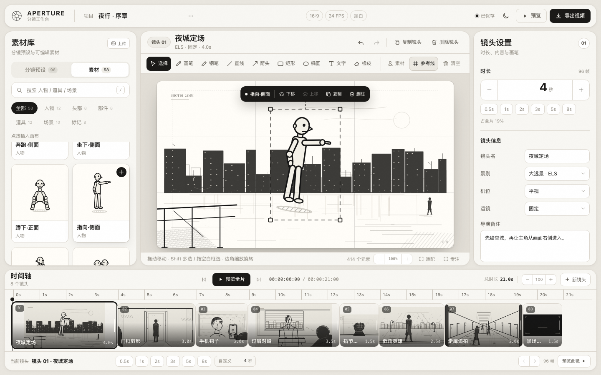

# APERTURE · 分镜工作台

黑白电影感的分镜与动画分镜工作台。96 个电影 / 短剧镜头预设 + 58 个可插入矢量素材，在一块可编辑画布上自由组合人物、道具和场景，在时间轴上设定每个镜头的时长，最后直接导出按镜头时长播放的 MP4 / WebM。

在线地址：**https://dowenow.com/fj/**  
GitHub 源码：**https://github.com/TofuBen/aperture-storyboard**

> 纯本地运行：无框架、无构建、无外部 CDN，所有画稿、时间轴、视频渲染都在浏览器里完成。



> 示例画面为手动打开的示例工程。首次打开网站时是空工程，不会自动载入示例。

## 启动

```bash
cd storyboard
python3 -m http.server 4173
```

打开 <http://127.0.0.1:4173>。也可以直接双击 `index.html`；建议用本地服务器，自动保存和视频导出会更稳定。

```bash
./start.sh          # 默认 4173 端口
./start.sh 8000     # 自定义端口
```

推荐 Chrome / Edge。新版 Safari 也可以；实际视频格式由浏览器 MediaRecorder 决定，Chrome 通常输出 **MP4 · H.264**。

## 首次打开与浏览器身份

- **默认空工程**：首次访问没有示例项目、没有时间轴镜头，也不会自动插入演示画面。
- Cookie `aperture_guest` 生成浏览器访客 ID；工程列表和当前工程按这个 ID 保存在该浏览器的 `localStorage` 中。
- 项目菜单 →「我的项目…」可以新建、切换、删除多个工程；首次进入时这个列表是空的。
- 清 Cookie 会变成新访客；换浏览器或换设备不会自动同步。
- 想体验示例时，点击空状态里的「打开示例」或项目菜单里的「载入示例项目」。
- 当前版本不做账号和跨设备云同步；工程数据只保存在当前浏览器。

## 这版重点更新

- **镜头直接操作**：镜头可一键复制；在时间轴上拖动镜头块可以直接调整顺序，向右拖右缘可以改时长。
- **素材可自由变换**：插入的人物、道具、场景都有 4 个角点缩放手柄和 1 个旋转手柄，右侧还可以输入缩放百分比、旋转角度。
- **多选与框选**：`Shift + 点击` 增加或移除选中对象；在空白处拖动可以框选多个对象，批量移动、复制、删除、对齐。[多选与对齐预览](docs/preview-multi.png)
- **对齐与分布**：多选后浮出「左 / 中 / 右 / 上 / 中 / 下 / 横匀 / 纵匀」，按画布边缘和中心对齐。
- **吸附参考线**：拖动对象靠近画布中心、三分线、边缘时会自动吸附并显示参考线，按住 `Alt` 临时关闭。
- **钢笔与节点编辑**：钢笔工具点击添加节点，点回起点闭合、`Enter` 完成；双击已有路径可拖动节点修改。
- **图片上传**：素材库右上角「上传」可导入 PNG/JPG/WebP，图片会自动压到适合画布的尺寸，作为可移动、缩放、旋转的图层。
- **多工程列表**：项目菜单 →「我的项目…」；Cookie 识别同一个浏览器，工程列表默认空，创建后自动保存。[项目列表预览](docs/preview-projects.png)
- **画布缩放/平移**：画布底部有 `− / 百分比 / +`；`⌘ / Ctrl + 滚轮` 缩放，鼠标中键拖动画布。
- **图层列表**：镜头设置里按图层列出当前画布元素，点一下就能选中被遮住的主体；`Shift + 点击` 图层可多选。
- **拖拽插入素材**：素材卡可以直接拖进画布，鼠标落点就是插入位置。
- **复制粘贴**：选中元素后 `⌘C` / `⌘V` 可在工程内复制粘贴；`⌘D` 仍是原地复制。
- **高对比度黑白主题**：亮色 / 深色两套主题，暖灰背景 + 近黑文字 + 圆角面板，去掉大量小号英文标签，整体字号与层级重新整理。
- **自己的素材库**：58 个可插入矢量素材，包括 12 个简化人物、8 个头部、8 个可拼装部件、12 个道具、10 个场景、8 个镜头标记。
- **人物几何模块化**：圆形头、方形/圆角矩形躯干、长条胶囊手臂和腿，方向与姿势一眼可读；素材作为一个整体插入，支持移动、缩放、旋转、复制、删除。
- **选中后直接操作**：选中元素后画布上浮出操作条；右键打开完整菜单。复制、删除、上移一层、下移一层不再藏在侧栏里。
- **橡皮擦修复**：所有线条和形状增加宽命中区，支持点按或拖动连续擦除；一次擦除可整体撤销。
- **更柔和的界面**：圆角卡片、统一系统无衬线字体、更高对比度和更少的装饰性小字。

## 核心功能

### 素材与预设

- 分镜预设 96 个，7 个分类：电影 14 / 短剧 14 / 对话 13 / 动作 14 / 情绪 14 / 空镜 14 / 基础 13。
- 素材 58 个，6 个分类：人物 12 / 头部 8 / 部件 8 / 道具 12 / 场景 10 / 标记 8。
- 左侧「分镜预设 / 素材」切换；支持搜索、分类筛选。点击预设加入时间轴，点击素材插入当前画布。
- 即使还没有镜头，点击素材也会自动创建一个空镜头并插入。
- 8 个精选预设组成可手动打开的示例项目《夜行 · 序章》。
- 项目菜单 →「我的项目…」：工程列表默认空；创建、切换、删除工程都保存在当前 Cookie 访客下。

### 画布

- 工具：选择、画笔、直线、箭头、矩形、椭圆、文字、橡皮。
- 选中元素后浮出操作条：**复制 / 删除 / 上移 / 下移**。
- 选中元素后出现 4 个角点缩放手柄和 1 个旋转手柄；右侧可输入缩放百分比与旋转角度。
- 素材可直接从素材库拖到画布上的指定位置；素材作为整体可移动、缩放、旋转、复制、删除。
- 右键元素打开上下文菜单；右键时间轴镜头可复制、删除、移动。
- 图层列表可选中被前景遮住的主体。[图层与变换面板预览](docs/preview-layers.png)
- 画布缩放：右下角 `− / 100% / +`，`⌘/Ctrl + 滚轮`；中键拖动画布平移。
- 文字双击可重新编辑。
- 线宽、填充（无 / 灰色 / 网线）、参考线、安全框、专注模式。
- 撤销 / 重做所有操作，撤销后仍保留当前选中元素。

### 时间轴

- 按真实时长比例排布；**拖动镜头块本身即可调整镜头顺序**，右侧浮出插入位置指示线。
- 拖动镜头块右边缘改时长，拖动时显示秒数，默认 0.1s 吸附，按住 `Shift` 以 0.5s 吸附。
- **复制镜头**：镜头设置头部按钮、右键菜单，或选中镜头后按 `⌘D / Ctrl+D`。
- 底部也有 0.5 / 1 / 2 / 3 / 5 / 8s 快捷时长与自定义秒数。
- 镜头复制、删除，时间指针跳转，50%–200% 缩放，整片预览与单镜预览。
- 右上角、时间轴头部与底部都可以进行预览和渲染操作。

### 预览与导出

- 全片动画预览：按每个镜头设定的时长逐镜硬切播放。
- 导出面板：1080P / 720P / 540P，24 / 30 FPS；可开关镜头信息条与轻微镜头推演。
- 视频在浏览器本地实时渲染，时长约等于成片长度，渲染时请保持页面可见。
- 渲染完成后可在面板内播放并下载视频。
- 另存 **镜头表 PNG**（缩略图 + 景别 + 时长 + 导演备注），适合发给客户或拍摄团队。
- 工程 JSON 导出 / 导入，自动保存到 `localStorage`。

### 主题与快捷键

- 右上角月亮 / 太阳图标切换亮色与深色主题，偏好会保存。
- 快捷键：`V` 选择、`P` 画笔、`L` 直线、`A` 箭头、`R` 矩形、`O` 椭圆、`T` 文字、`E` 橡皮、`G` 参考线、`Space` 预览。
- 选中元素后：`Delete` 删除、`⌘D` / `Ctrl+D` 原地复制、`⌘C` / `⌘V` 复制粘贴。
- 多选：`Shift + 点击`，或在选择工具下拖空白区域框选。
- 双击文字进入编辑；双击钢笔路径进入节点编辑；钢笔状态下 `Enter` 完成路径、`Esc` 取消。
- 拖动对象靠近画布中心/三分线/边缘会吸附，按住 `Alt` 可临时关闭吸附。
- 没有选中元素时，`⌘D` 复制当前镜头。
- `⌘Z` / `Ctrl+Z` 撤销、`⇧⌘Z` 重做；撤销后保留当前选中的元素。

## 文件结构

```
storyboard/
├─ index.html
├─ styles.css
├─ js/
│  ├─ presets.js         96 个分镜预设
│  ├─ assets.js          58 个可插入矢量素材
│  ├─ drawing.js         矢量渲染、命中区、SVG 栅格化
│  └─ app.js             编辑器、时间轴、历史、素材、预览、导出
├─ docs/
│  ├─ ASSET_CONTRACT.md  素材数据契约
│  ├─ PRESET_CONTRACT.md 预设数据契约
│  ├─ preview.png
│  ├─ preview-layers.png
│  ├─ preview-multi.png
│  ├─ preview-projects.png
│  ├─ preview-animatic.png
│  ├─ preview-export.png
│  └─ preview-dark.png
├─ start.sh
└─ README.md
```

## 渲染参数

| 选项 | 值 |
|---|---|
| 画幅 | 16:9 黑白 |
| 分辨率 | 1920×1080 / 1280×720 / 960×540 |
| 帧率 | 24 / 30 FPS |
| 转场 | 硬切 |
| 镜头信息条 | 可开关（默认开启） |
| 镜头微推 | 可开关（默认开启，约 1.8%） |
| 时长 | 由时间轴内每个镜头的秒数决定 |

## 已验证

- 首次访问为空工程，项目列表为空；Cookie 写入、刷新后恢复当前工程和项目列表正常。
- 示例项目可手动打开；镜头一键复制、时间轴直接拖动排序、右缘改时长均正常。
- 58 个素材及 6 个分类加载正常；点击插入和拖拽插入都可用。
- 人物/道具/场景作为整体可选中、移动、缩放、旋转、复制、删除、擦除；角点缩放和旋转手柄实测有效，右侧缩放/旋转输入同步。
- 多选：Shift 点击/图层 Shift、空白框选、批量移动、复制、删除、对齐左/中/右/上/中/下均正常。
- 钢笔：点击建路径、闭合、`Enter` 完成、双击路径拖动节点修改均正常；图片上传、移动、缩放、旋转和导出正常。
- 项目菜单：项目列表空态、新建、切换、删除、刷新恢复均正常。
- 图层列表点击选中、上移/下移层级正常。
- 画布缩放按钮、`⌘ + 滚轮` 缩放、中键拖动平移正常。
- 复制粘贴、吸附参考线、撤销/重做保留选中元素正常。
- 含素材、图片、钢笔路径和变换的 0.5s 单镜导出 MP4 1920×1080，可在导出面板内播放并下载；镜头表 PNG、工程 JSON、刷新恢复均验证通过。
- 1440 / 1024 / 390 三种宽度无横向页面溢出；移动端空状态、素材库抽屉、上传与素材插入正常。
- Chrome headless 全流程 0 条 console error / pageerror。

## 已知说明

- 视频无音轨，时长以镜头时间轴为准；MediaRecorder 实时录制会带来约 1 帧的长度误差。
- Firefox 等浏览器的录制容器可能为 WebM；页面会自动检测可用的 MediaRecorder 格式。
- 画布以 16:9 固定画幅输出。
- Cookie 只用于区分浏览器访客；工程数据存储在本机浏览器，不跨设备同步，也没有账号登录。
- 成组/解组、对象锁定/隐藏、贝塞尔曲柄控制尚未纳入本版；后续可以继续做。
